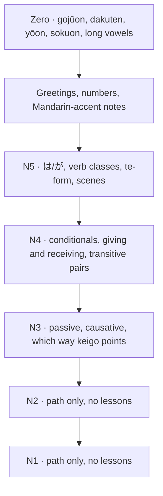
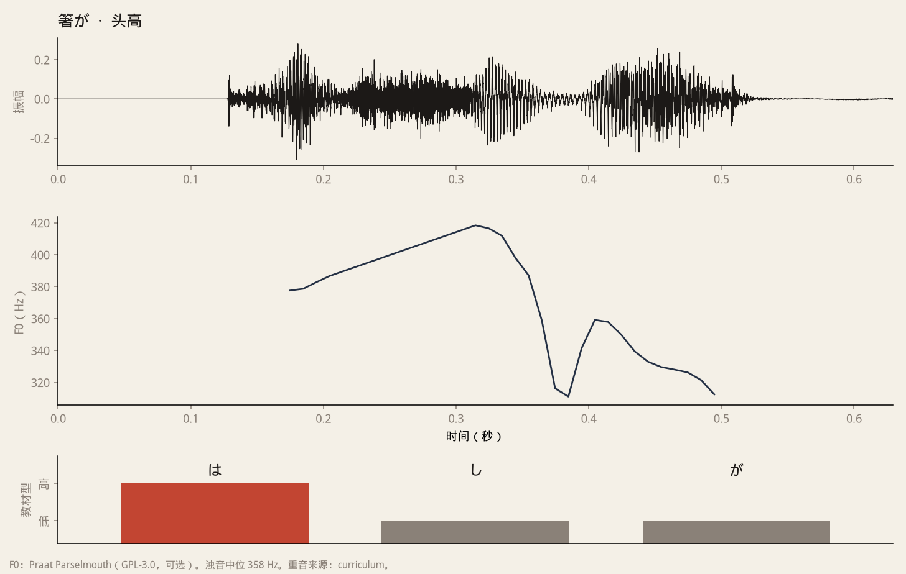
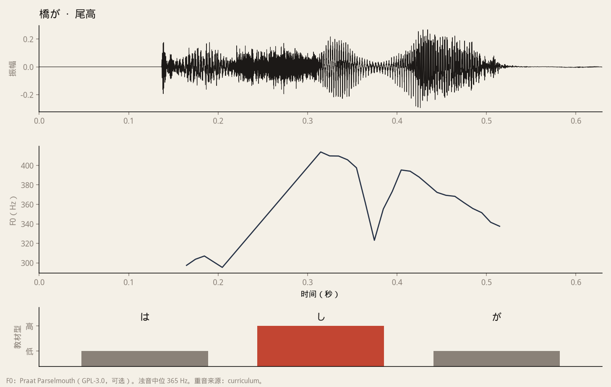
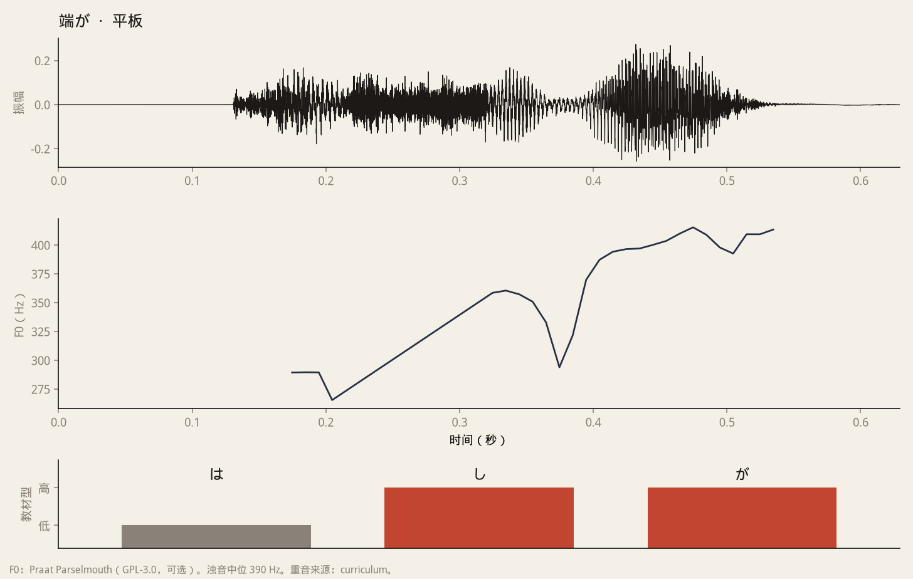
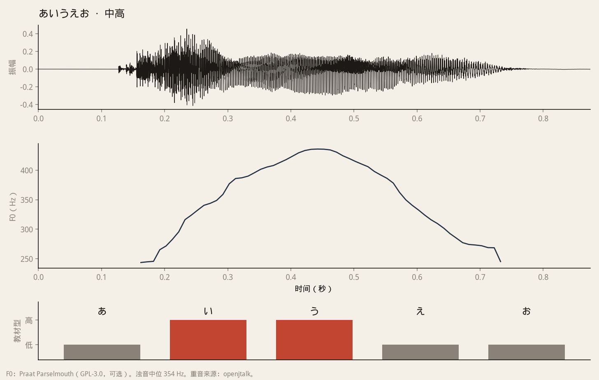
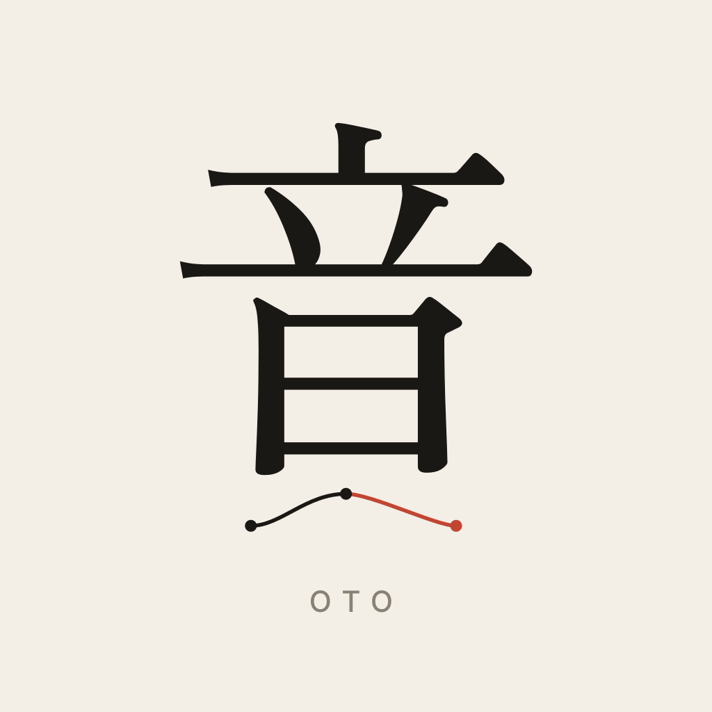
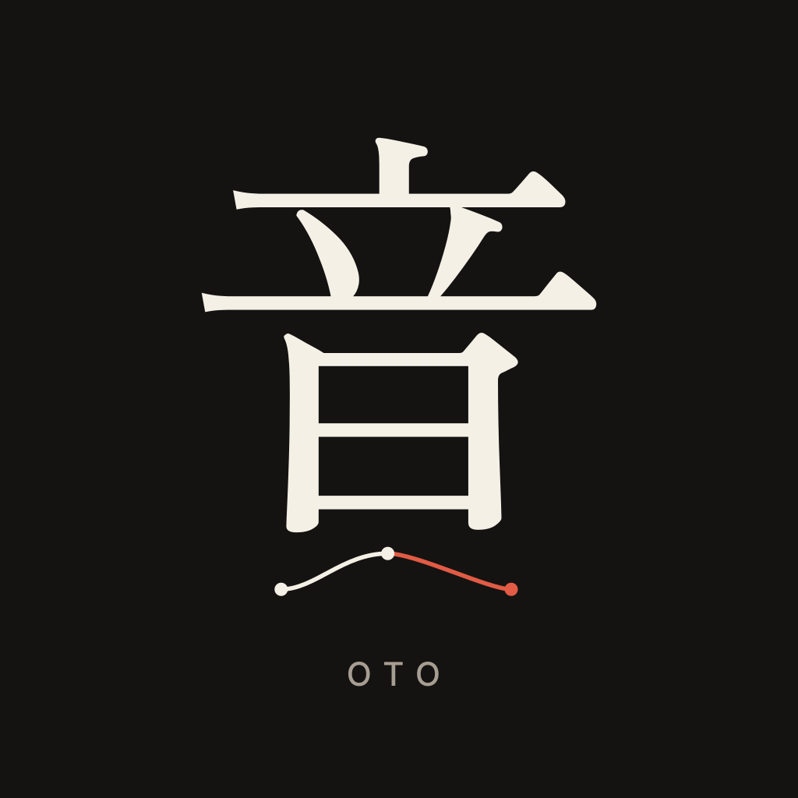

<p align="center">
  
</p>

<p align="center">
  <a href="LICENSE"></a>
  <a href="LICENSE-CONTENT"></a>
  <a href="pyproject.toml"></a>
</p>

<p align="center">
  A Japanese course for Mandarin speakers, from no kana through N5, N4, and N3.<br>
  Pronunciation is one module.
</p>

The Chinese README is the primary one: [README.md](README.md). Teaching text is in Chinese. This page is the map, the commands, and the measurements from a real run.

Oto asks the learner to produce a line first, then corrects one thing. Kanji are used as a memory aid and, in the same breath, as a source of false friends. Progress lives outside the skill directory. Pitch pattern and measured F0 are drawn in separate panels.

## Curriculum



Counts from `oto stats` on this tree:

| | |
|---|---|
| Kana | 122 |
| Vocabulary | 98 |
| Kanji | 54 |
| Grammar | 46 |
| Scenarios | 6 |
| Listening / speaking / reading / writing | 3 each |
| Pronunciation items | 14 |
| False friends | 45 |
| Error types | 19 |
| On-reading correspondences | 10 |
| Shinjitai and kokuji notes | 42 |
| Safer cognates | 15 |
| Items | 352 |
| Units | 35, plus 2 empty N2 / N1 scaffolds |

False friends include 手紙, 勉強, 丈夫, 大丈夫, 大家, 汽車, 走る, 愛人, 新聞, 女中, and 流石. On-reading notes are tendencies, not laws.

## Install

```bash
python3 -m venv .venv
.venv/bin/pip install -e ".[teach]"
.venv/bin/oto place
```

`[praat]` adds Parselmouth (GPL-3.0) for F0. Without it, analysis falls back to a NumPy autocorrelation. Scores (`[score]`), JMdict (`[dict]`), transcription (`[asr]`), apkg (`[anki]`), and VOICEVOX are separate installs. CI does not install them. Learner state defaults to `~/.oto/learner.yaml` (`--learner` or `OTO_LEARNER`). `OTO_DATA` overrides the curriculum directory.

## Claude Code, Cursor, Codex

[SKILL.md](SKILL.md) is the skill. Symlink the repo, and keep learner files out of it.

```bash
mkdir -p ~/.claude/skills ~/.cursor/skills ~/.codex/skills
ln -s "$PWD" ~/.claude/skills/oto
ln -s "$PWD" ~/.cursor/skills/oto
ln -s "$PWD" ~/.codex/skills/oto
```

[AGENTS.md](AGENTS.md) points Codex at the same rules. Use the CLI for lessons and pitch. Do not invent accent nuclei or scores.

## Commands

```bash
oto plan --minutes 30
oto place --submit k1=a,k2=b
oto lesson --commit
oto review
oto grade v-tegami --rating good
oto mistake --error gram-wa-ga --detail "used が for the topic"
oto lookup 手紙
oto reference 箸
oto speak あいうえお -o /tmp/aiueo.wav --engine voicevox
oto analyze /tmp/aiueo.wav --text あいうえお --chart /tmp/aiueo.png
oto analyze /tmp/aiueo.wav --text あいうえお --transcribe
oto pitch 箸 橋 端 -o /tmp/hashi.png --engine voicevox --particle が
oto export anki -o cards.csv --all
oto export anki -o cards.apkg --format apkg --all
oto setup
```

`--date YYYY-MM-DD` pins "today". New cards are due the next day. Intervals are whole days.

## A real lesson

Kana answers were right and the later items were left blank, so placement landed on N5. The false-friend unit was then forced:

```bash
oto --date 2026-11-22 place --submit 'k1=a,k2=b,k3=b,k4=b'
oto --date 2026-11-22 lesson --unit vocab-traps --force --commit
```

```text
30 分钟 · n5 · 2026-11-22
同形語  第一批同形词

二、新的一步（先做）
1. 用日语说「信」。先说，再写。
2. 用日语说「学习」。先说，再写。
3. 用日语说「没关系、不用了」。先说，再写。
4. 用日语说「结实」。先说，再写。
5. 用日语说「蒸汽火车」。先说，再写。

三、先读这一句，再说中文意思
手紙を書きます。
```

The answer key stays under the divider. Full output: [docs/examples/lesson-traps.txt](docs/examples/lesson-traps.txt). The next day those five cards were due: [docs/examples/review.txt](docs/examples/review.txt).

Lookup. With `.[dict]` installed, the curriculum hit is followed by a JMdict entry. Full output: [docs/examples/lookup-tegami.txt](docs/examples/lookup-tegami.txt).

```text
手紙：日语 信；中文常作 卫生纸。
手紙 てがみ 信 平板，核=0。单独：て↓ が↑ み↑。加「が」：て↓ が↑ み↑ が↑
JMdict（JMdict / EDRDG, CC BY-SA 4.0）
- [id#1327720] てがみ (手紙) : letter/missive/note/mail ((noun (common) (futsuumeishi)))
引擎读音 テガミ / 发音 テガミ
```

## A real synthesis and measurement

The example audio is VOICEVOX. This machine has no Docker, so the image `voicevox/voicevox_engine:cpu-latest` was not used. The run used the official Linux CPU wheel `voicevox_core` 0.17.1 and the official downloader. The voice library is `0.vvm`, style 四国めたん / ノーマル (style id 2). The downloader's default ONNX Runtime 1.17.3 does not satisfy the wheel, which loads `libvoicevox_onnxruntime.so.1.23.2`. Synthesis started after that library was fetched. Publish these wavs with the credit `VOICEVOX:四国めたん`. It is a character voice, not a model to imitate and not an NHK reading.

```bash
oto speak あいうえお -o docs/examples/aiueo.wav --engine voicevox
oto pitch 箸 橋 端 -o docs/examples/hashi-trio.png --engine voicevox --particle が
```

[docs/examples/aiueo.wav](docs/examples/aiueo.wav). The command printout is [docs/examples/speak-aiueo.txt](docs/examples/speak-aiueo.txt):

```text
已写入 docs/examples/aiueo.wav
引擎 voicevox
署名 VOICEVOX:四国めたん
使用了语音库，公开这段音频时请注明「VOICEVOX:四国めたん」。不要把角色音当成标准发音教师。
```

Isolated 橋 (odaka) and 端 (heiban) are both low-high. The fall is on the following particle, so each word was synthesized with が. The three curves in [docs/examples/hashi-trio.png](docs/examples/hashi-trio.png) are not the same. 箸が starts high and falls. 橋が rises, then falls on the particle. 端が rises and stays high. The dip near 0.37 s is the consonant of が, not an alignment mark. The vermilion text is the textbook pattern and is not time-aligned.

<p align="center">
  
</p>

A median does not separate the three patterns. Parselmouth numbers, also in [docs/examples/f0-medians.txt](docs/examples/f0-medians.txt):

```text
hashi-trio-箸が.wav  0.629s  sr 24000  voiced frames 23  median 357.9 Hz
hashi-trio-橋が.wav  0.629s  sr 24000  voiced frames 26  median 365.1 Hz
hashi-trio-端が.wav  0.629s  sr 24000  voiced frames 26  median 389.9 Hz
aiueo.wav            0.875s  sr 24000  voiced frames 58  median 354.4 Hz
```

`oto analyze` on 箸が. The hatsuon ONNX was exported once on this machine with `hatsuon-export` (argmax agreement with torch 1.000). It stays in the cache and is not in the repo.

```text
分析 箸が

头高，核=1。单独：は↑ し↓。加「が」：は↑ し↓ が↓
F0 后端 parselmouth，浊音帧 23，中位 358 Hz。
图 docs/examples/hashi-analysis.png
hatsuon 综合 71.6，准确 67.5，重音 100.0，信心 0.667。
  箸 ハシ 词分 53.5 重音结果 correct 核 1 ハ:mispronounced/6.9/预期H/音高ok シ:correct/100.0/预期L/音高ok
  が ガ 词分 95.6 重音结果 unknown 核 None ガ:correct/95.6/预期L/音高—
```

<p align="center">
  
</p>

The bottom panel is the textbook high/low pattern, not an alignment of the F0. ハ is marked mispronounced at 6.9. シ and が are correct. Overall 71.6, pitch 100.0. That is feedback, not a grade.

橋が and 端が have the expected mora levels. Full output: [docs/examples/analyze-hashi-橋.txt](docs/examples/analyze-hashi-橋.txt), [docs/examples/analyze-hashi-端.txt](docs/examples/analyze-hashi-端.txt).

```text
分析 橋が
尾高，核=2。单独：は↓ し↑。加「が」：は↓ し↑ が↓
hatsuon 综合 98.8，准确 98.8，重音 None，信心 0.833。
  橋 ハシ 词分 98.2 重音结果 unknown 核 2 ハ:correct/96.5/预期L/音高— シ:correct/100.0/预期H/音高—
  が ガ 词分 100.0 重音结果 unknown 核 None ガ:correct/100.0/预期L/音高—

分析 端が
平板，核=0。单独：は↓ し↑。加「が」：は↓ し↑ が↑
hatsuon 综合 94.5，准确 94.5，重音 None，信心 0.667。
  端 ハシ 词分 92.5 重音结果 unknown 核 0 ハ:correct/85.0/预期L/音高— シ:correct/100.0/预期H/音高—
  が ガ 词分 98.6 重音结果 unknown 核 None ガ:correct/98.6/预期H/音高—
```

The word-level accent result is unknown and the pitch score is None. hatsuon puts が in the next phrase, so the odaka and heiban fall is outside the word phrase and is not scored. That blank was left blank. The F0 charts are the evidence the two utterances separate: [docs/examples/hashi-analysis-橋.png](docs/examples/hashi-analysis-橋.png), [docs/examples/hashi-analysis-端.png](docs/examples/hashi-analysis-端.png).

<p align="center">
  
  
</p>

あいうえお is in [docs/examples/analyze-aiueo.txt](docs/examples/analyze-aiueo.txt). Overall 39.0, accuracy 60.0, pitch 100.0. ア, ウ, and オ are correct. イ and エ are marked deleted. The reading is one nakadaka phrase, nucleus 3, which is not a tone for each vowel. [docs/examples/aiueo-analysis.png](docs/examples/aiueo-analysis.png) uses the VOICEVOX wav for the waveform and F0. The bottom bars come from OpenJTalk's phrase split.

<p align="center">
  
</p>

Transcription uses the CTranslate2 weights of Kotoba-Whisper v2.0 through faster-whisper, CPU int8, temperature fixed at 0. Decoding the same file twice produced the same text, and neither text is the target. [docs/examples/transcribe-hashi.txt](docs/examples/transcribe-hashi.txt) writes 箸が as 歌詞は. [docs/examples/transcribe-aiueo.txt](docs/examples/transcribe-aiueo.txt) writes あいうえお as あゆえを. The transcriber runs. On these short synthetic clips it did not hear the sentence.

The Anki package from this run is [docs/examples/oto-n3.apkg](docs/examples/oto-n3.apkg): 352 cards, 205018 bytes, from `oto export anki -o docs/examples/oto-n3.apkg --format apkg --all`.

## Engines

| Engine | In this run | Without it |
|---|---|---|
| pyopenjtalk-plus | Readings and engine accent. It did not synthesize the wavs above | `oto speak` uses it when VOICEVOX is absent |
| praat-parselmouth | F0 in the charts | NumPy autocorrelation |
| hatsuon 0.1 | Model exported. Mora scores and the pitch scores above | Analysis continues without mora scores |
| VOICEVOX CORE 0.17.1 CPU | Synthesized the wavs | Falls back to OpenJTalk |
| Kotoba-Whisper v2.0 (faster-whisper int8) | Ran. Both short clips were misheard | No transcript |
| jamdict + jamdict_data 1.5 | `oto lookup 手紙` returned the JMdict line above | Curriculum and false friends only |
| genanki | Wrote `oto-n3.apkg` | CSV only |

hatsuon is tuned on native speech, not on learner speech. A score is feedback, not a grade. Export the ONNX yourself with CPU torch and `hatsuon-export`. It is not in this repo. 24 kHz audio is resampled with librosa / soxr. If that import fails, Oto resamples to 16 kHz with NumPy and tries again. The accent dictionary is attached to the lexical word. A single kana reading is not copied onto every accent key, which would swallow が.

VOICEVOX CORE 0.16+ is MIT. Voice models are not. Audio that uses 四国めたん must be credited `VOICEVOX:四国めたん`. Point `OTO_VOICEVOX_DIR` at the download. `oto setup` lists what this machine actually has: [docs/examples/setup.txt](docs/examples/setup.txt).

## Review

The default scheduler is FSRS-4.5 with the published initial weights and retention 0.9. Set `scheduler: sm2` in the learner file for SM-2. Anki export is CSV, or apkg when genanki is installed. The package above is the 352-card export. Anki reschedules on its own. FSRS state is not copied.

## Limits

- Lessons stop at N3. N2 and N1 are prerequisites and a sentence.
- Pitch is a Tokyo teaching pattern. Items that carry `accent` were checked against OpenJTalk. On a disagreement the lesson keeps the curriculum value and says the engine is not an NHK dictionary.
- hatsuon is not calibrated on learner speech. For odaka and heiban followed by が, the word-level pitch score can be empty. Read the F0 chart. An empty score is neither a pass nor a fail.
- Kotoba-Whisper did not recover the target on these short synthetic clips.
- There is no viseme grade. The hatsuon model, the VOICEVOX voices, and the JMdict database are not in the repo, and CI does not install them.
- Intervals are whole days.
- This is not official JLPT material, and it does not hear the learner.

## Third parties

| Piece | License | In this repo |
|---|---|---|
| Code, tests, brand | MIT | Yes |
| Curriculum YAML, placement, false friends, error notes | CC BY-SA 4.0 | Yes |
| pyopenjtalk-plus | MIT | Optional install |
| OpenJTalk, hts_engine | Modified BSD | Via that package |
| HTS voice `nitech_jp_atr503_m001` | Credit Nagoya Institute of Technology | Not vendored |
| praat-parselmouth | GPL-3.0 | Optional. Closed-source distribution must accept the GPL |
| hatsuon | MIT, alpha | Model not included |
| VOICEVOX CORE 0.16+ | MIT | Not included. Voices have their own terms |
| 四国めたん | [voice terms](https://zunko.jp/con_ongen_kiyaku.html) | Not included |
| Kotoba-Whisper v2.0 | Apache-2.0 | Download on demand |
| JMdict / EDRDG | CC BY-SA 4.0 | Not vendored. jamdict the code is MIT |
| Session shape from [japanese-tutor](https://github.com/13rianK/japanese-tutor) | MIT, 13rianK | Review first, one point, then the learner produces. The Chinese engine, the graph, and the measurements are Oto's |

Glyph outlines in the logo are from SIL OFL fonts: Zen Old Mincho (Yoshimichi Ohira), Noto Sans SC (Google), Inter (Rasmus Andersson). The pitch contour is original.

## Mark

<p>
  
  
</p>

[logo-light.svg](assets/brand/logo-light.svg), [logo-dark.svg](assets/brand/logo-dark.svg), [banner.svg](assets/brand/banner.svg). [scripts/render_brand.py](scripts/render_brand.py) rebuilds them. The fonts are not in the repo.
