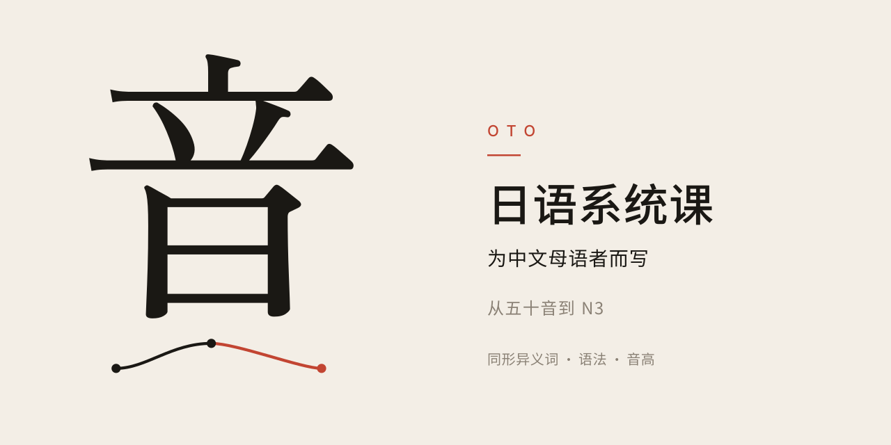
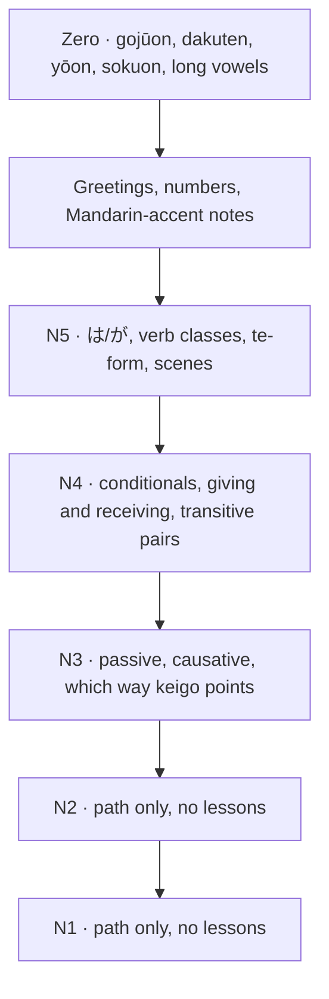
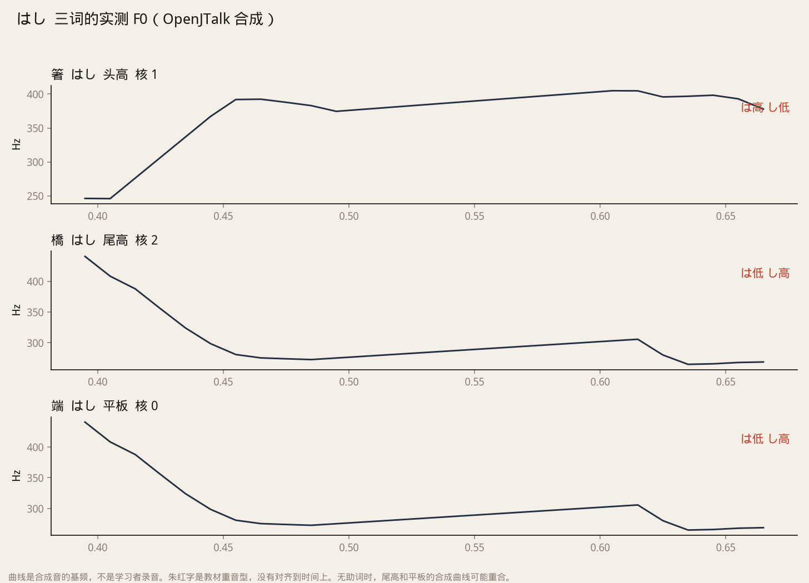

<p align="center">
  
</p>

<p align="center">
  <a href="LICENSE"></a>
  <a href="LICENSE-CONTENT"></a>
  <a href="pyproject.toml"></a>
</p>

<p align="center">
  A Japanese course for Mandarin speakers, from no kana through N5, N4, and N3.<br>
  Pronunciation is one module.
</p>

The Chinese README is the primary one: [README.md](README.md). Teaching text is in Chinese. This page is the map, the commands, and the measurements from a real run.

Oto asks the learner to produce a line first, then corrects one thing. Kanji are used as a memory aid and, in the same breath, as a source of false friends. Progress lives outside the skill directory. Pitch pattern and measured F0 are drawn in separate panels.

## Curriculum



Counts from `oto stats` on this tree:

| | |
|---|---|
| Kana | 122 |
| Vocabulary | 98 |
| Kanji | 54 |
| Grammar | 46 |
| Scenarios | 6 |
| Listening / speaking / reading / writing | 3 each |
| Pronunciation items | 14 |
| False friends | 45 |
| Error types | 19 |
| On-reading correspondences | 10 |
| Shinjitai and kokuji notes | 42 |
| Safer cognates | 15 |
| Items | 352 |
| Units | 35, plus 2 empty N2 / N1 scaffolds |

False friends include 手紙, 勉強, 丈夫, 大丈夫, 大家, 汽車, 走る, 愛人, 新聞, 女中, and 流石. On-reading notes are tendencies, not laws.

## Install

```bash
python3 -m venv .venv
.venv/bin/pip install -e ".[teach]"
.venv/bin/oto place
```

`[praat]` adds Parselmouth (GPL-3.0) for F0. Without it, analysis falls back to a NumPy autocorrelation. Learner state defaults to `~/.oto/learner.yaml` (`--learner` or `OTO_LEARNER`). `OTO_DATA` overrides the curriculum directory.

## Claude Code, Cursor, Codex

[SKILL.md](SKILL.md) is the skill. Symlink the repo, and keep learner files out of it.

```bash
mkdir -p ~/.claude/skills ~/.cursor/skills ~/.codex/skills
ln -s "$PWD" ~/.claude/skills/oto
ln -s "$PWD" ~/.cursor/skills/oto
ln -s "$PWD" ~/.codex/skills/oto
```

[AGENTS.md](AGENTS.md) points Codex at the same rules. Use the CLI for lessons and pitch. Do not invent accent nuclei or scores.

## Commands

```bash
oto plan --minutes 30
oto place --submit k1=a,k2=b
oto lesson --commit
oto review
oto grade v-tegami --rating good
oto mistake --error gram-wa-ga --detail "used が for the topic"
oto lookup 手紙
oto reference 箸
oto speak あいうえお -o /tmp/aiueo.wav --engine openjtalk
oto analyze /tmp/aiueo.wav --text あいうえお --chart /tmp/aiueo.png
oto pitch 箸 橋 端 -o /tmp/hashi.png
oto export anki -o cards.csv --all
oto setup
```

`--date YYYY-MM-DD` pins "today". New cards are due the next day. Intervals are whole days.

## A real lesson

Kana answers were right and the later items were left blank, so placement landed on N5. The false-friend unit was then forced:

```bash
oto --date 2026-11-22 place --submit 'k1=a,k2=b,k3=b,k4=b'
oto --date 2026-11-22 lesson --unit vocab-traps --force --commit
```

```text
30 分钟 · n5 · 2026-11-22
同形語  第一批同形词

二、新的一步（先做）
1. 用日语说「信」。先说，再写。
2. 用日语说「学习」。先说，再写。
3. 用日语说「没关系、不用了」。先说，再写。
4. 用日语说「结实」。先说，再写。
5. 用日语说「蒸汽火车」。先说，再写。

三、先读这一句，再说中文意思
手紙を書きます。
```

The answer key stays under the divider. Full output: [docs/examples/lesson-traps.txt](docs/examples/lesson-traps.txt). The next day those five cards were due: [docs/examples/review.txt](docs/examples/review.txt).

Lookup:

```text
手紙：日语 信；中文常作 卫生纸。
手紙 てがみ 信 平板，核=0。单独：て↓ が↑ み↑。加「が」：て↓ が↑ み↑ が↑
引擎读音 テガミ / 发音 テガミ
```

## A real synthesis and measurement

`oto speak` wrote [docs/examples/aiueo.wav](docs/examples/aiueo.wav) with OpenJTalk and the HTS voice `nitech_jp_atr503_m001` (Nagoya Institute of Technology). It is a synthetic reference, not a native recording and not a voice to imitate.

`oto pitch 箸 橋 端` synthesized the three words and plotted measured F0. The vermilion text in [docs/examples/hashi-trio.png](docs/examples/hashi-trio.png) is the textbook pattern. It is not time-aligned.

<p align="center">
  
</p>

Medians from Parselmouth on those files, also in [docs/examples/f0-medians.txt](docs/examples/f0-medians.txt):

```text
hashi-trio-箸.wav  1.030s  voiced frames 15  median 392.0 Hz
hashi-trio-橋.wav  1.030s  voiced frames 16  median 280.6 Hz
hashi-trio-端.wav  1.030s  voiced frames 16  median 280.6 Hz
aiueo.wav          1.155s  voiced frames 47  median 365.1 Hz
```

In this run the 橋 and 端 contours matched. Odaka and heiban separate on the following particle, and this HTS voice did not produce two different curves. Do not read the chart as three accents already split in the signal.

`oto analyze` on 箸, verbatim:

```text
分析 箸

头高，核=1。单独：は↑ し↓。加「が」：は↑ し↓ が↓
F0 后端 parselmouth，浊音帧 15，中位 392 Hz。
图 docs/examples/hashi-analysis.png
hatsuon 未用：resampling from 48000 Hz needs: pip install 'hatsuon[audio]'
```

<p align="center">
  
</p>

The bottom panel is the textbook high/low pattern, not an alignment of the F0. The Mandarin reminders look at the target reading only. They are not a diagnosis. The ONNX Runtime warning in the raw log is pyopenjtalk's optional nani predictor. It was not installed, and it does not change the numbers above.

The あいうえお chart is [docs/examples/aiueo-analysis.png](docs/examples/aiueo-analysis.png). OpenJTalk treated the whole string as one accent phrase (nakadaka, nucleus 3). That is not a tone for each vowel.

## Engines

| Engine | In this run | Without it |
|---|---|---|
| pyopenjtalk-plus | Synthesized the wavs above | `oto speak` unavailable |
| praat-parselmouth | F0 in the charts | NumPy autocorrelation |
| hatsuon 0.1 | Installed, model absent. The call stopped at resampling. No score | Analysis continues without mora scores |
| VOICEVOX | Runtime and voice not downloaded | Falls back to OpenJTalk |
| Kotoba-Whisper v2.0 | torch not installed. `--transcribe` was not run | No transcript |

hatsuon is tuned on native speech. Even after `hatsuon-export`, a score is feedback, not a grade. The ONNX model is not in this repo. VOICEVOX CORE 0.16+ is MIT; voice models are not. Audio that uses 四国めたん must be credited `VOICEVOX:四国めたん`. See `oto setup`.

## Review

The default scheduler is FSRS-4.5 with the published initial weights and retention 0.9. Set `scheduler: sm2` in the learner file for SM-2. Anki export is CSV, or apkg when genanki is installed. Anki reschedules on its own. FSRS state is not copied.

## Limits

- Lessons stop at N3. N2 and N1 are prerequisites and a sentence.
- Pitch is a Tokyo teaching pattern. Items that carry `accent` were checked against OpenJTalk. On a disagreement the lesson keeps the curriculum value and says the engine is not an NHK dictionary.
- There is no L2-calibrated pronunciation score and no viseme grade.
- Intervals are whole days.
- This is not official JLPT material, and it does not hear the learner.

## Third parties

| Piece | License | In this repo |
|---|---|---|
| Code, tests, brand | MIT | Yes |
| Curriculum YAML, placement, false friends, error notes | CC BY-SA 4.0 | Yes |
| pyopenjtalk-plus | MIT | Optional install |
| OpenJTalk, hts_engine | Modified BSD | Via that package |
| HTS voice `nitech_jp_atr503_m001` | Credit Nagoya Institute of Technology | Not vendored |
| praat-parselmouth | GPL-3.0 | Optional. Closed-source distribution must accept the GPL |
| hatsuon | MIT, alpha | Model not included |
| VOICEVOX CORE 0.16+ | MIT | Not included. Voices have their own terms |
| 四国めたん | [voice terms](https://zunko.jp/con_ongen_kiyaku.html) | Not included |
| Kotoba-Whisper v2.0 | Apache-2.0 | Download on demand |
| JMdict / EDRDG | CC BY-SA 4.0 | Not vendored. jamdict the code is MIT |
| Session shape from [japanese-tutor](https://github.com/13rianK/japanese-tutor) | MIT, 13rianK | Review first, one point, then the learner produces. The Chinese engine, the graph, and the measurements are Oto's |

Glyph outlines in the logo are from SIL OFL fonts: Zen Old Mincho (Yoshimichi Ohira), Noto Sans SC (Google), Inter (Rasmus Andersson). The pitch contour is original.

## Mark

<p>
  
  
</p>

[logo-light.svg](assets/brand/logo-light.svg), [logo-dark.svg](assets/brand/logo-dark.svg), [banner.svg](assets/brand/banner.svg). [scripts/render_brand.py](scripts/render_brand.py) rebuilds them. The fonts are not in the repo.
