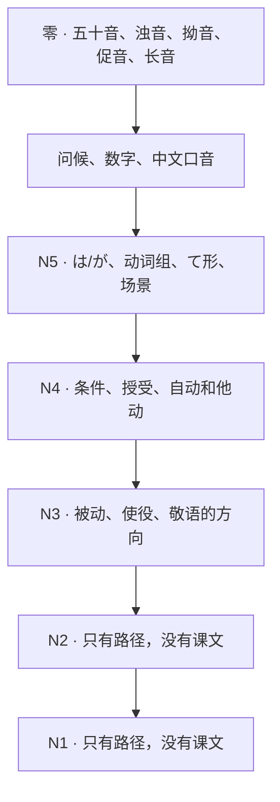
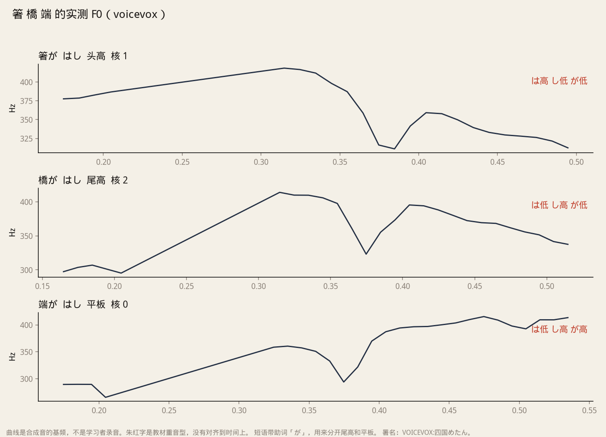
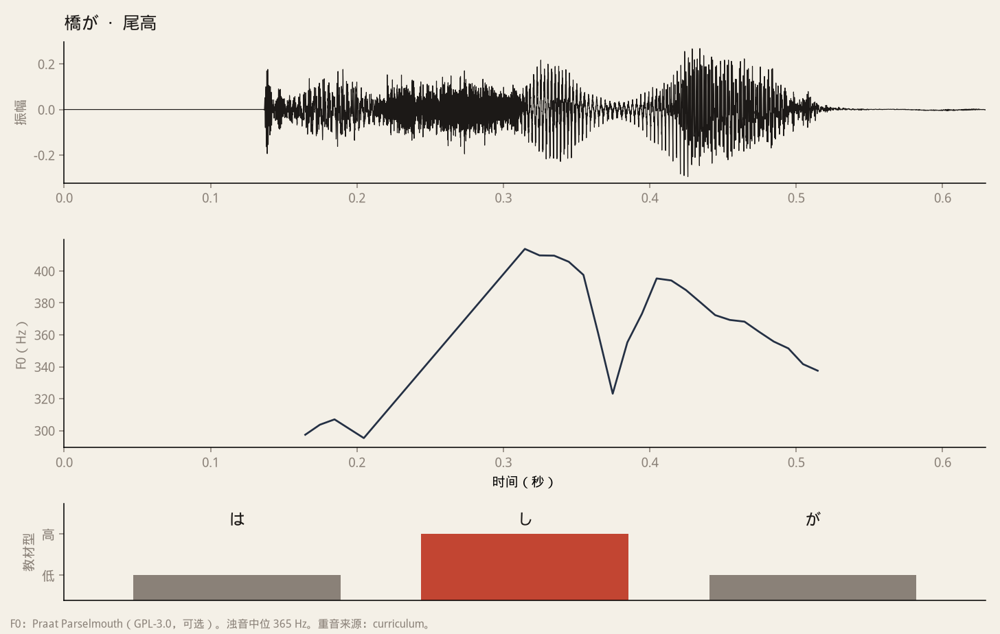
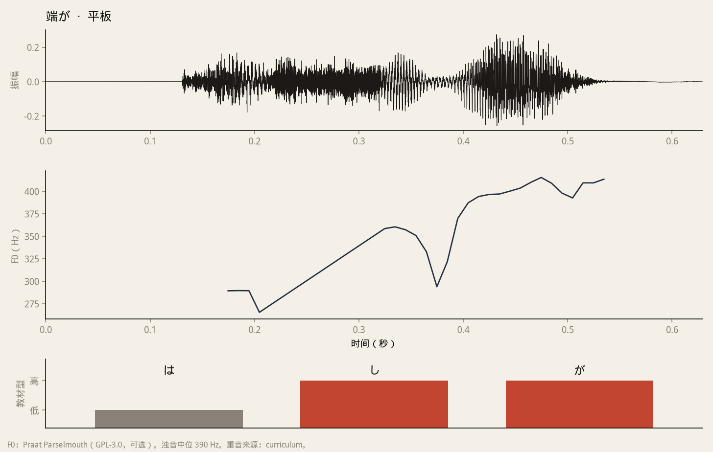
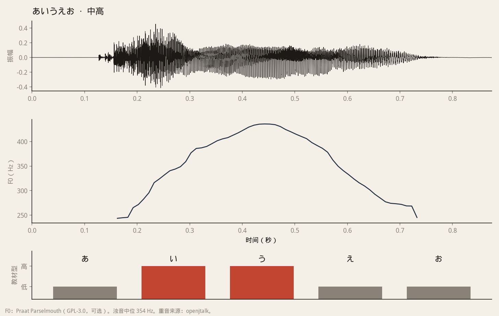

<p align="center">
  
</p>

<p align="center">
  <a href="LICENSE"></a>
  <a href="LICENSE-CONTENT"></a>
  <a href="pyproject.toml"></a>
</p>

<p align="center">
  给简体中文母语者的日语课。从还不会假名开始，走到 N5、N4、N3。<br>
  发音是其中一课，不是全部。
</p>

英文说明见 [README.en.md](README.en.md)。

Oto 让学习者先说出或写出一句，再给很短的纠正。汉字用来记音读，同时标出同形异义词。进度写在技能目录外面。音高型来自教材或引擎词典，基频来自这一条录音，两张图不假装对齐。

## 课程



`oto stats` 在这棵树上的计数：

| | |
|---|---|
| 假名 | 122 |
| 词汇 | 98 |
| 汉字 | 54 |
| 语法 | 46 |
| 场景 | 6 |
| 听 / 说 / 读 / 写 | 各 3 |
| 发音条目 | 14 |
| 同形异义词 | 45 |
| 错误类型 | 19 |
| 音读对应 | 10 |
| 新字体与国字 | 42 |
| 可借用的汉字词 | 15 |
| 条目合计 | 352 |
| 单元 | 35，另有 2 个空的 N2 / N1 路径 |

同形词里有手紙、勉強、丈夫、大丈夫、大家、汽車、走る、愛人、新聞、女中、流石。音读对应写成倾向，不写成定律，例如中古 -ng 常对应う或い，入声常对应く、つ、き、ち。

## 安装

```bash
python3 -m venv .venv
.venv/bin/pip install -e ".[teach]"
.venv/bin/oto place
```

要画基频并尽量用 Praat，再装 `.[praat]`。这一项是 GPL-3.0，不装也能跑，会退回 numpy 的自相关。发音分数（`.[score]`）、JMdict（`.[dict]`）、转写（`.[asr]`）、apkg（`.[anki]`）和 VOICEVOX 都是另外装的。CI 只跑不带这些依赖的测试。

进度默认在 `~/.oto/learner.yaml`。换路径用 `--learner`，或环境变量 `OTO_LEARNER`。课程数据可用 `OTO_DATA` 指到别的目录。

## 装进 Claude Code、Cursor、Codex

仓库根目录的 [SKILL.md](SKILL.md) 就是技能。把本仓库链到技能目录，不要把学习档案放进去。

```bash
# Claude Code
mkdir -p ~/.claude/skills
ln -s "$PWD" ~/.claude/skills/oto

# Cursor
mkdir -p ~/.cursor/skills
ln -s "$PWD" ~/.cursor/skills/oto

# Codex
mkdir -p ~/.codex/skills
ln -s "$PWD" ~/.codex/skills/oto
```

在本仓库里，Codex 也会读到 [AGENTS.md](AGENTS.md)。课上用命令，不要凭记忆编重音或分数。

## 命令

```bash
oto plan --minutes 30
oto place
oto place --submit k1=a,k2=b
oto lesson --commit
oto review
oto grade v-tegami --rating good
oto mistake --error gram-wa-ga --detail "把は说成了が"
oto quiz --unit vocab-traps --seed 1
oto lookup 手紙
oto reference 箸
oto speak あいうえお -o /tmp/aiueo.wav --engine voicevox
oto analyze /tmp/aiueo.wav --text あいうえお --chart /tmp/aiueo.png
oto analyze /tmp/aiueo.wav --text あいうえお --transcribe
oto pitch 箸 橋 端 -o /tmp/hashi.png --engine voicevox --particle が
oto export anki -o cards.csv --all
oto export anki -o cards.apkg --format apkg --all
oto setup
```

`--date 2026-11-22` 把「今天」固定住，方便补课和测试。新卡片从第二天进入复习。间隔按天取整，没有一小时以内的学习步。

## 一节真课

下面是这次在仓库里跑出来的，不是写好的范文。分班只答对了假名，级别落到 N5，然后强制上同形词那一课：

```bash
oto --learner docs/examples/learner.yaml --date 2026-11-22 place --submit 'k1=a,k2=b,k3=b,k4=b'
oto --learner docs/examples/learner.yaml --date 2026-11-22 lesson --unit vocab-traps --force --commit
```

```text
音  Oto
30 分钟 · n5 · 2026-11-22
同形語  第一批同形词

一、复习（先做，不要往下翻）
今天没有到期的卡片。

二、新的一步（先做）
1. 用日语说「信」。先说，再写。
2. 用日语说「学习」。先说，再写。
3. 用日语说「没关系、不用了」。先说，再写。
4. 用日语说「结实」。先说，再写。
5. 用日语说「蒸汽火车」。先说，再写。

三、先读这一句，再说中文意思
手紙を書きます。
```

对照在分隔线下面。第二天再跑 `oto review --date 2026-11-23`，这五张卡片到期。完整输出在 [docs/examples/lesson-traps.txt](docs/examples/lesson-traps.txt) 和 [docs/examples/review.txt](docs/examples/review.txt)。

查词。装了 `.[dict]` 之后，课文和同形词后面会附上 JMdict。完整输出在 [docs/examples/lookup-tegami.txt](docs/examples/lookup-tegami.txt)：

```text
查 手紙

同形词
- 手紙：日语 信；中文常作 卫生纸。卫生纸说トイレットペーパー。不要在邮局或别人家里把「手紙」理解成纸。
课文
- 手紙 てがみ 信 平板，核=0。单独：て↓ が↑ み↑。加「が」：て↓ が↑ み↑ が↑
JMdict（JMdict / EDRDG, CC BY-SA 4.0）
https://www.edrdg.org/wiki/index.php/JMdict-EDICT_Dictionary_Project
- [id#1327720] てがみ (手紙) : letter/missive/note/mail ((noun (common) (futsuumeishi)))
引擎读音 テガミ / 发音 テガミ
```

## 一次真的合成和测量

这次的示例音频是 VOICEVOX 合成的。本机没有 Docker，所以没有跑 `voicevox/voicevox_engine:cpu-latest`，用的是官方 Linux CPU 轮子 `voicevox_core` 0.17.1 和官方下载器。声库是 `0.vvm`，风格是四国めたん / ノーマル（style id 2）。下载器默认的 ONNX Runtime 1.17.3 对不上轮子要求的 `libvoicevox_onnxruntime.so.1.23.2`，换成 1.23.2 之后才出声。公开这些 wav 时署名 `VOICEVOX:四国めたん`。这是角色音，不是要模仿的标准教师，也不是 NHK 审定。

```bash
oto speak あいうえお -o docs/examples/aiueo.wav --engine voicevox
oto pitch 箸 橋 端 -o docs/examples/hashi-trio.png --engine voicevox --particle が
```

音频是 [docs/examples/aiueo.wav](docs/examples/aiueo.wav)。`oto speak` 的原样输出在 [docs/examples/speak-aiueo.txt](docs/examples/speak-aiueo.txt)：

```text
已写入 docs/examples/aiueo.wav
引擎 voicevox
署名 VOICEVOX:四国めたん
使用了语音库，公开这段音频时请注明「VOICEVOX:四国めたん」。不要把角色音当成标准发音教师。
```

尾高的橋和平板的端，单独念都是「低高」。下降落在后面的助词上，所以三个词都带了「が」。[docs/examples/hashi-trio.png](docs/examples/hashi-trio.png) 里三条曲线不一样：箸が从高处落到低处，橋が先升再在助词上落下，端が升上去之后停在高处。大约 0.37 秒的凹口是「が」的辅音，不是用来把三条曲线对齐的。朱红字是教材型，没有贴到时间轴上。

<p align="center">
  
</p>

中位只说明整段有多高，分不开这三型。Parselmouth 的数字写在 [docs/examples/f0-medians.txt](docs/examples/f0-medians.txt)：

```text
hashi-trio-箸が.wav  0.629s  sr 24000  浊音帧 23  中位 357.9 Hz
hashi-trio-橋が.wav  0.629s  sr 24000  浊音帧 26  中位 365.1 Hz
hashi-trio-端が.wav  0.629s  sr 24000  浊音帧 26  中位 389.9 Hz
aiueo.wav            0.875s  sr 24000  浊音帧 58  中位 354.4 Hz
```

单独分析「箸が」。hatsuon 的 ONNX 是本机跑过一次 `hatsuon-export` 得到的（和 torch 的 argmax 一致率 1.000），放在缓存里，不进仓库。`oto analyze` 的原样输出：

```text
分析 箸が

头高，核=1。单独：は↑ し↓。加「が」：は↑ し↓ が↓
F0 后端 parselmouth，浊音帧 23，中位 358 Hz。
图 docs/examples/hashi-analysis.png
hatsuon 综合 71.6，准确 67.5，重音 100.0，信心 0.667。
hatsuon 0.1 只用母语者语料调过阈值，没有用学习者数据校准。下面的数字是反馈，不是成绩，也不要据此给等级。
  箸 ハシ 词分 53.5 重音结果 correct 核 1 ハ:mispronounced/6.9/预期H/音高ok シ:correct/100.0/预期L/音高ok
  が ガ 词分 95.6 重音结果 unknown 核 None ガ:correct/95.6/预期L/音高—
```

<p align="center">
  
</p>

下面那一栏是教材的高低，不是从基频里对齐出来的。ハ 被标成 mispronounced、6.9，シ 和 が 是 correct。综合 71.6，重音 100.0。这是反馈，不是成绩。

橋が和端が的拍级预期是对的。完整输出在 [docs/examples/analyze-hashi-橋.txt](docs/examples/analyze-hashi-橋.txt) 和 [docs/examples/analyze-hashi-端.txt](docs/examples/analyze-hashi-端.txt)：

```text
分析 橋が
尾高，核=2。单独：は↓ し↑。加「が」：は↓ し↑ が↓
hatsuon 综合 98.8，准确 98.8，重音 None，信心 0.833。
  橋 ハシ 词分 98.2 重音结果 unknown 核 2 ハ:correct/96.5/预期L/音高— シ:correct/100.0/预期H/音高—
  が ガ 词分 100.0 重音结果 unknown 核 None ガ:correct/100.0/预期L/音高—

分析 端が
平板，核=0。单独：は↓ し↑。加「が」：は↓ し↑ が↑
hatsuon 综合 94.5，准确 94.5，重音 None，信心 0.667。
  端 ハシ 词分 92.5 重音结果 unknown 核 0 ハ:correct/85.0/预期L/音高— シ:correct/100.0/预期H/音高—
  が ガ 词分 98.6 重音结果 unknown 核 None ガ:correct/98.6/预期H/音高—
```

词级重音结果是 unknown，重音分是 None。hatsuon 把「が」收成下一个短语，尾高和平板的下降不在词短语里面，它就不打重音分。这个空分没有被填上。基频图才是「这两句被分开了」的证据：[docs/examples/hashi-analysis-橋.png](docs/examples/hashi-analysis-橋.png)、[docs/examples/hashi-analysis-端.png](docs/examples/hashi-analysis-端.png)。

<p align="center">
  
  
</p>

あいうえお的原样输出在 [docs/examples/analyze-aiueo.txt](docs/examples/analyze-aiueo.txt)。综合 39.0，准确 60.0，重音 100.0。ア、ウ、オ 是 correct，イ 和 エ 被标成 deleted。注音把整串收成一个中高短语（核 3）。那不是五个元音各自的声调。图在 [docs/examples/aiueo-analysis.png](docs/examples/aiueo-analysis.png)：音频和基频来自上面的 VOICEVOX wav，底栏的中高型来自 OpenJTalk 的短语切分。

<p align="center">
  
</p>

转写用的是 Kotoba-Whisper v2.0 的 CTranslate2 权重，`faster-whisper`，CPU int8，温度固定为 0。同一条音频解码两次，文本相同，但都不是目标句。[docs/examples/transcribe-hashi.txt](docs/examples/transcribe-hashi.txt) 把箸が写成了「歌詞は」。[docs/examples/transcribe-aiueo.txt](docs/examples/transcribe-aiueo.txt) 把あいうえお写成了「あゆえを」。转写能跑。这两条短合成音，它没有听对。

Anki 包是这次导出的：[docs/examples/oto-n3.apkg](docs/examples/oto-n3.apkg)，352 张卡片，205018 字节。命令是 `oto export anki -o docs/examples/oto-n3.apkg --format apkg --all`。

## 发音引擎

| 引擎 | 这次仓库里 | 没有它时 |
|---|---|---|
| pyopenjtalk-plus | 注音、引擎重音对照。上面的 wav 不是它合成的 | 没有 VOICEVOX 时，`oto speak` 用它 |
| praat-parselmouth | 上图的 F0 | 改用 numpy 自相关 |
| hatsuon 0.1 | 模型已导出，打出了上面的 mora 分和重音分 | 分析继续，只是没有 mora 分 |
| VOICEVOX CORE 0.17.1 CPU | 合成了上面的 wav | 自动改用 OpenJTalk |
| Kotoba-Whisper v2.0（faster-whisper int8） | 跑了。两条短音都没有听对 | 不转写 |
| jamdict + jamdict_data 1.5 | `oto lookup 手紙` 返回了上面的 JMdict 词条 | 只有课文和同形词 |
| genanki | 写出了 `oto-n3.apkg` | 只有 CSV |

hatsuon 只用母语者语料调过阈值，没有用学习者数据校准。分数是反馈，不是成绩，也不要据此给等级。模型自己跑 `hatsuon-export`（CPU 版 torch），不进这个仓库。24 kHz 的音频由 librosa / soxr 重采样；这一步失败时，Oto 用 numpy 重采样到 16 kHz 再试一次。重音只挂在词本身上。整句如果只有一个假名读音，不会抄到每一个词上，否则「が」会被吃掉。

VOICEVOX 的核心库从 0.16 起是 MIT，声库不是。用了四国めたん就要署名 `VOICEVOX:四国めたん`。下载目录给 `OTO_VOICEVOX_DIR`。`oto setup` 会列出本机到底装了什么，这次的输出在 [docs/examples/setup.txt](docs/examples/setup.txt)。

## 复习

默认是 FSRS-4.5 的公开初始权重，期望保持率 0.9。也可以在档案里把 `scheduler` 改成 `sm2`。Anki 导出默认是 CSV。装了 genanki 才能写 apkg，这次写出的就是上面的 352 张卡片。导出去之后由 Anki 自己安排，FSRS 的内部状态不会跟着走。

## 界限

- 课文写到 N3。N2、N1 只有先修和一句说明。
- 音高是东京音的教学型。写了 `accent` 的词用 OpenJTalk 对过；引擎和教材不一致时，课上以教材为准，并说明引擎不是 NHK 审定。
- hatsuon 没有用学习者数据校准。尾高和平板带「が」时，词级重音分可以是空的。看基频图，不要把空分当成读对了或读错了。
- 这次的短合成音，Kotoba-Whisper 没有听成目标句。
- 没有口型评分。hatsuon 模型、VOICEVOX 声库、JMdict 数据库都不在仓库里，CI 也不安装。
- 间隔按整天计算。
- 这不是 JLPT 官方材料，也不能代替老师听你说话。

## 第三方

| 部分 | 许可 | 在本仓库 |
|---|---|---|
| 本仓库代码、测试、品牌图 | MIT | 在 |
| 课程 YAML、分班、同形词和错误库 | CC BY-SA 4.0 | 在 |
| pyopenjtalk-plus | MIT | 不附带，可选安装 |
| OpenJTalk、hts_engine | 修改版 BSD | 随上面的包 |
| HTS 音 `nitech_jp_atr503_m001` | 使用时保留名古屋工业大学署名 | 不单独分发 |
| praat-parselmouth | GPL-3.0 | 可选。和闭源一起分发要承担 GPL 义务 |
| hatsuon | MIT，alpha | 不附带模型 |
| VOICEVOX CORE 0.16+ | MIT | 不附带。声库另有规约 |
| 四国めたん | [音源利用规约](https://zunko.jp/con_ongen_kiyaku.html) | 不附带 |
| Kotoba-Whisper v2.0 | Apache-2.0 | 按需下载 |
| JMdict / EDRDG | CC BY-SA 4.0 | 不进仓库。jamdict 代码是 MIT |
| 会话结构参考 [japanese-tutor](https://github.com/13rianK/japanese-tutor) | MIT，13rianK | 只借鉴「先复习、一个重点、让人产出」。中文引擎、课程图和发音测量是 Oto 的 |

品牌字轮廓来自 SIL OFL 字体，嵌进 SVG 之后显示不再依赖这些字体：Zen Old Mincho（大平善道）、Noto Sans SC（Google）、Inter（Rasmus Andersson）。音高曲线是原创几何。

## 标识

<p>
  
  
</p>

[assets/brand/logo-light.svg](assets/brand/logo-light.svg)、[assets/brand/logo-dark.svg](assets/brand/logo-dark.svg)、[assets/brand/banner.svg](assets/brand/banner.svg)。重新生成见 [scripts/render_brand.py](scripts/render_brand.py)，字体不进仓库。
