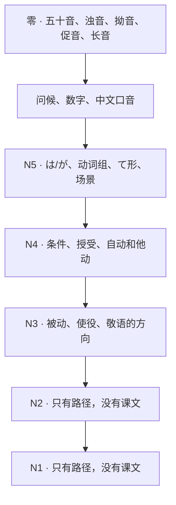
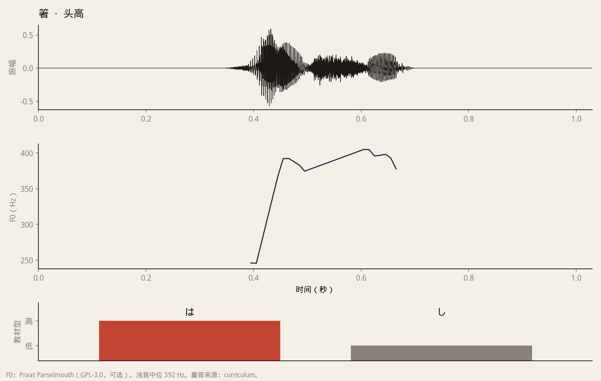
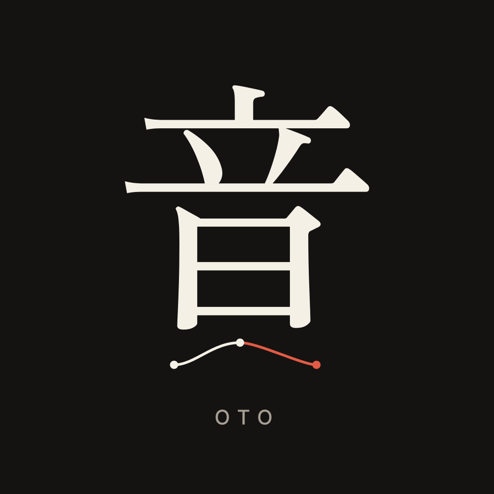

<p align="center">
  
</p>

<p align="center">
  <a href="LICENSE"></a>
  <a href="LICENSE-CONTENT"></a>
  <a href="pyproject.toml"></a>
</p>

<p align="center">
  给简体中文母语者的日语课。从还不会假名开始，走到 N5、N4、N3。<br>
  发音是其中一课，不是全部。
</p>

英文说明见 [README.en.md](README.en.md)。

Oto 让学习者先说出或写出一句，再给很短的纠正。汉字用来记音读，同时标出同形异义词。进度写在技能目录外面。音高型来自教材或引擎词典，基频来自这一条录音，两张图不假装对齐。

## 课程



`oto stats` 在这棵树上的计数：

| | |
|---|---|
| 假名 | 122 |
| 词汇 | 98 |
| 汉字 | 54 |
| 语法 | 46 |
| 场景 | 6 |
| 听 / 说 / 读 / 写 | 各 3 |
| 发音条目 | 14 |
| 同形异义词 | 45 |
| 错误类型 | 19 |
| 音读对应 | 10 |
| 新字体与国字 | 42 |
| 可借用的汉字词 | 15 |
| 条目合计 | 352 |
| 单元 | 35，另有 2 个空的 N2 / N1 路径 |

同形词里有手紙、勉強、丈夫、大丈夫、大家、汽車、走る、愛人、新聞、女中、流石。音读对应写成倾向，不写成定律，例如中古 -ng 常对应う或い，入声常对应く、つ、き、ち。

## 安装

```bash
python3 -m venv .venv
.venv/bin/pip install -e ".[teach]"
.venv/bin/oto place
```

要画基频并尽量用 Praat，再装 `.[praat]`。这一项是 GPL-3.0，不装也能跑，会退回 numpy 的自相关。

进度默认在 `~/.oto/learner.yaml`。换路径用 `--learner`，或环境变量 `OTO_LEARNER`。课程数据可用 `OTO_DATA` 指到别的目录。

## 装进 Claude Code、Cursor、Codex

仓库根目录的 [SKILL.md](SKILL.md) 就是技能。把本仓库链到技能目录，不要把学习档案放进去。

```bash
# Claude Code
mkdir -p ~/.claude/skills
ln -s "$PWD" ~/.claude/skills/oto

# Cursor
mkdir -p ~/.cursor/skills
ln -s "$PWD" ~/.cursor/skills/oto

# Codex
mkdir -p ~/.codex/skills
ln -s "$PWD" ~/.codex/skills/oto
```

在本仓库里，Codex 也会读到 [AGENTS.md](AGENTS.md)。课上用命令，不要凭记忆编重音或分数。

## 命令

```bash
oto plan --minutes 30
oto place
oto place --submit k1=a,k2=b
oto lesson --commit
oto review
oto grade v-tegami --rating good
oto mistake --error gram-wa-ga --detail "把は说成了が"
oto quiz --unit vocab-traps --seed 1
oto lookup 手紙
oto lookup 読む --jmdict          # 需要 .[dict]，词典不进仓库
oto reference 箸
oto speak あいうえお -o /tmp/aiueo.wav --engine openjtalk
oto analyze /tmp/aiueo.wav --text あいうえお --chart /tmp/aiueo.png
oto pitch 箸 橋 端 -o /tmp/hashi.png
oto export anki -o cards.csv --all
oto setup
```

`--date 2026-11-22` 把「今天」固定住，方便补课和测试。新卡片从第二天进入复习。间隔按天取整，没有一小时以内的学习步。

## 一节真课

下面是这次在仓库里跑出来的，不是写好的范文。分班只答对了假名，级别落到 N5，然后强制上同形词那一课：

```bash
oto --learner docs/examples/learner.yaml --date 2026-11-22 place --submit 'k1=a,k2=b,k3=b,k4=b'
oto --learner docs/examples/learner.yaml --date 2026-11-22 lesson --unit vocab-traps --force --commit
```

```text
音  Oto
30 分钟 · n5 · 2026-11-22
同形語  第一批同形词

一、复习（先做，不要往下翻）
今天没有到期的卡片。

二、新的一步（先做）
1. 用日语说「信」。先说，再写。
2. 用日语说「学习」。先说，再写。
3. 用日语说「没关系、不用了」。先说，再写。
4. 用日语说「结实」。先说，再写。
5. 用日语说「蒸汽火车」。先说，再写。

三、先读这一句，再说中文意思
手紙を書きます。
```

对照在分隔线下面。第二天再跑 `oto review --date 2026-11-23`，这五张卡片到期。完整输出在 [docs/examples/lesson-traps.txt](docs/examples/lesson-traps.txt) 和 [docs/examples/review.txt](docs/examples/review.txt)。

查词：

```text
查 手紙

同形词
- 手紙：日语 信；中文常作 卫生纸。卫生纸说トイレットペーパー。不要在邮局或别人家里把「手紙」理解成纸。
课文
- 手紙 てがみ 信 平板，核=0。单独：て↓ が↑ み↑。加「が」：て↓ が↑ み↑ が↑
引擎读音 テガミ / 发音 テガミ
```

## 一次真的合成和测量

`oto speak` 用 OpenJTalk 写出了 [docs/examples/aiueo.wav](docs/examples/aiueo.wav)。署名是 HTS voice `nitech_jp_atr503_m001`（名古屋工业大学）。这是合成参考音，不是母语者，也不是学习者该去模仿的音色。

`oto pitch 箸 橋 端` 合成了三个词，并画出实测基频。[docs/examples/hashi-trio.png](docs/examples/hashi-trio.png) 里的朱红字是教材重音型，没有贴到时间轴上。

<p align="center">
  
</p>

同一批文件再用 Parselmouth 算浊音中位，结果写在 [docs/examples/f0-medians.txt](docs/examples/f0-medians.txt)：

```text
hashi-trio-箸.wav  1.030s  浊音帧 15  中位 392.0 Hz
hashi-trio-橋.wav  1.030s  浊音帧 16  中位 280.6 Hz
hashi-trio-端.wav  1.030s  浊音帧 16  中位 280.6 Hz
aiueo.wav          1.155s  浊音帧 47  中位 365.1 Hz
```

橋和端的曲线在这次合成里是重合的。尾高和平板要靠后面的助词才分开，这套 HTS 音没有把两个词读成两条不同的曲线。不要把这张图读成「三个重音都已经在声波里分开了」。

单独分析「箸」的原样输出：

```text
分析 箸

头高，核=1。单独：は↑ し↓。加「が」：は↑ し↓ が↓
F0 后端 parselmouth，浊音帧 15，中位 392 Hz。
图 docs/examples/hashi-analysis.png
hatsuon 未用：resampling from 48000 Hz needs: pip install 'hatsuon[audio]'

提醒（看的是目标音，不是诊断）
- し更接近「西」的声母，不是「思」。
- 这是头高，全词只有一个下倾，不是每个字一个普通话声调。
```

<p align="center">
  
</p>

下面那一栏是教材的高低，不是从基频里对齐出来的。中文提醒也只看目标音里有哪些音，不诊断这条录音。开头那行 ONNX Runtime 警告来自 pyopenjtalk 的可选 nani 预测，没有装，也不影响上面的数字。

あいうえお的图在 [docs/examples/aiueo-analysis.png](docs/examples/aiueo-analysis.png)。OpenJTalk 把整串收成一个重音短语（中高，核 3）。那不是五个元音各自的声调。

## 发音引擎

| 引擎 | 这次仓库里 | 没有它时 |
|---|---|---|
| pyopenjtalk-plus | 已合成上述 wav | `oto speak` 不可用 |
| praat-parselmouth | 上图的 F0 | 改用 numpy 自相关 |
| hatsuon 0.1 | 包在，模型不在。调用停在重采样，没有分数 | 分析继续，只是没有 mora 分 |
| VOICEVOX | 没下载运行时和声库 | 自动改用 OpenJTalk |
| Kotoba-Whisper v2.0 | 没装 torch，没有跑 `--transcribe` | 不转写 |

hatsuon 只用母语者语料调过阈值。就算以后导出了模型，分数也只是反馈，不是成绩。模型要自己跑 `hatsuon-export`，不进这个仓库。

VOICEVOX 的核心库从 0.16 起是 MIT，声库不是。用了四国めたん就要署名 `VOICEVOX:四国めたん`。下载目录给 `OTO_VOICEVOX_DIR`，步骤在 `oto setup`。

## 复习

默认是 FSRS-4.5 的公开初始权重，期望保持率 0.9。也可以在档案里把 `scheduler` 改成 `sm2`。Anki 导出是 CSV；装了 genanki 才能写 apkg。导出去之后由 Anki 自己安排，FSRS 的内部状态不会跟着走。

## 界限

- 课文写到 N3。N2、N1 只有先修和一句说明。
- 音高是东京音的教学型。写了 `accent` 的词用 OpenJTalk 对过；引擎和教材不一致时，课上以教材为准，并说明引擎不是 NHK 审定。
- 没有学习者发音的校准分，也没有口型评分。
- 间隔按整天计算。
- 这不是 JLPT 官方材料，也不能代替老师听你说话。

## 第三方

| 部分 | 许可 | 在本仓库 |
|---|---|---|
| 本仓库代码、测试、品牌图 | MIT | 在 |
| 课程 YAML、分班、同形词和错误库 | CC BY-SA 4.0 | 在 |
| pyopenjtalk-plus | MIT | 不附带，可选安装 |
| OpenJTalk、hts_engine | 修改版 BSD | 随上面的包 |
| HTS 音 `nitech_jp_atr503_m001` | 使用时保留名古屋工业大学署名 | 不单独分发 |
| praat-parselmouth | GPL-3.0 | 可选。和闭源一起分发要承担 GPL 义务 |
| hatsuon | MIT，alpha | 不附带模型 |
| VOICEVOX CORE 0.16+ | MIT | 不附带。声库另有规约 |
| 四国めたん | [音源利用规约](https://zunko.jp/con_ongen_kiyaku.html) | 不附带 |
| Kotoba-Whisper v2.0 | Apache-2.0 | 按需下载 |
| JMdict / EDRDG | CC BY-SA 4.0 | 不进仓库。jamdict 代码是 MIT |
| 会话结构参考 [japanese-tutor](https://github.com/13rianK/japanese-tutor) | MIT，13rianK | 只借鉴「先复习、一个重点、让人产出」。中文引擎、课程图和发音测量是 Oto 的 |

品牌字轮廓来自 SIL OFL 字体，嵌进 SVG 之后显示不再依赖这些字体：Zen Old Mincho（大平善道）、Noto Sans SC（Google）、Inter（Rasmus Andersson）。音高曲线是原创几何。

## 标识

<p>
  
  
</p>

[assets/brand/logo-light.svg](assets/brand/logo-light.svg)、[assets/brand/logo-dark.svg](assets/brand/logo-dark.svg)、[assets/brand/banner.svg](assets/brand/banner.svg)。重新生成见 [scripts/render_brand.py](scripts/render_brand.py)，字体不进仓库。
